# Control-Plane Storage and Durable Node Registry Architecture

## 1. Overview

In AegisEdge Phase 6.28 Stage 5, the control-plane node registry is persisted durably in SQLite and rehydrated into in-memory structures upon startup. This guarantees that edge node registrations, heartbeats, and telemetry activity survive control-plane process restarts while preserving AegisEdge's core invariant:

$$\text{EDGE OPERATES OFFLINE} \longrightarrow \text{PERSISTS TO WAL} \longrightarrow \text{RECONNECTS} \longrightarrow \text{SYNCHRONIZES IDEMPOTENTLY}$$

---

## 2. Storage Schema (`cp_nodes`)

The node registry is stored in the `cp_nodes` table within the control-plane SQLite database alongside `cp_ingested_batches` and `cp_telemetry_payloads`.

```sql
CREATE TABLE IF NOT EXISTS cp_nodes (
    node_id           TEXT PRIMARY KEY NOT NULL,
    status            TEXT NOT NULL,
    last_seen         TEXT NOT NULL,
    registered_at        TEXT NOT NULL,
    agent_version        TEXT NOT NULL DEFAULT '',
    protocol_version     TEXT NOT NULL DEFAULT '',
    hostname             TEXT NOT NULL DEFAULT '',
    os                   TEXT NOT NULL DEFAULT '',
    architecture         TEXT NOT NULL DEFAULT '',
    capabilities_json    TEXT NOT NULL DEFAULT '[]',
    labels_json          TEXT NOT NULL DEFAULT '{}',
    sequence_number      INTEGER NOT NULL DEFAULT 0,
    heartbeat_sequence   INTEGER NOT NULL DEFAULT 0,
    metadata_version     INTEGER NOT NULL DEFAULT 0,
    metadata_updated_at  TEXT NOT NULL DEFAULT '',
    created_at           TEXT NOT NULL DEFAULT CURRENT_TIMESTAMP,
    updated_at           TEXT NOT NULL DEFAULT CURRENT_TIMESTAMP
);

CREATE INDEX IF NOT EXISTS idx_cp_nodes_reg_order 
    ON cp_nodes(registered_at ASC, node_id ASC);

CREATE INDEX IF NOT EXISTS idx_cp_nodes_last_seen 
    ON cp_nodes(last_seen ASC);
```

### Key Design Properties
1. **Primary Key:** `node_id TEXT NOT NULL` guarantees device uniqueness.
2. **Timestamps:** Canonical zero-padded fixed-width UTC strings (`"2006-01-02T15:04:05.000000000Z"`, 30 characters) format timestamps across `registered_at`, `last_seen`, `metadata_updated_at`, `created_at`, and `updated_at`, preventing variable-precision sorting anomalies.
3. **Structured Collections:** `capabilities_json` and `labels_json` serialize arrays and maps cleanly with safe default values (`'[]'`, `'{}'`).
4. **Deterministic Ordering Index:** The composite index `idx_cp_nodes_reg_order ON cp_nodes(registered_at ASC, node_id ASC)` guarantees a deterministic, tie-broken query ordering across database restarts without relying on SQLite internal rowids.
5. **Separation of Sequence Domains:**
   - `sequence_number` (INTEGER): Tracks the telemetry WAL monotonic sequence counter.
   - `heartbeat_sequence` (INTEGER): Tracks the edge agent coordinator monotonic heartbeat counter.
   The two sequence counters operate in completely independent sequence domains and are never compared across domains.
6. **Separation of Metadata Freshness:**
   - `registered_at`: Immutable enrollment time set upon first registration.
   - `metadata_version` & `metadata_updated_at`: Explicit metadata version and update timestamp allowing edge nodes to update mutable configuration without regressing to stale registration payloads or relying on liveness timestamps.

---

## 3. Storage Contracts and Semantics

The storage interface `IdempotencyStore` (`services/control-plane/storage/store.go`) defines the node persistence contract:

### 3.1 Node Registration (`RegisterNode`)
- **Initial Registration:** Inserts a new record into `cp_nodes`. Returns `(isNew = true, nil)`.
- **Duplicate Registration:**
  - `registered_at` is **immutable** and permanently preserved as the original enrollment timestamp in storage.
  - `status` is **preserved** (never resets a node that might be `DEGRADED` or `OFFLINE` back to default).
  - `sequence_number` and `heartbeat_sequence` are **monotonic** (never regress; `MAX(existing, requested)`).
  - `last_seen` is updated if the registration timestamp is strictly newer (`eventTime.After(existLastSeen)`).
  - **Metadata Freshness Rules:**
    Metadata updates (`hostname`, `agent_version`, `protocol_version`, `os`, `architecture`, `capabilities`, `labels`) are evaluated independently of liveness (`last_seen`) using explicit versioning and timestamps:
    1. **Precedence Hierarchy:**
       - **Version Precedence:** A higher `metadata_version` (`MetadataVersion`) always takes precedence over a lower version.
       - **Timestamp Fallback:** If `metadata_version` is equal, metadata timestamps are compared. The incoming update uses `UpdatedAt` if explicitly provided; if `UpdatedAt` is omitted or zero, the control plane falls back to `RegisteredAt` from the registration payload.
       - **Strict Chronological Evaluation:** If the incoming metadata timestamp is strictly newer (`reqMetaTime.After(existMetaTime)`), metadata is updated; if strictly older (`reqMetaTime.Before(existMetaTime)`), the update is rejected as stale.
       - **Equal-Version / Equal-Timestamp Tie-Breaking:** If both `metadata_version` and metadata timestamps are equal, incoming non-empty metadata fields overwrite stored values (arrival order determines the winner between conflicting non-empty fields). Empty optional fields preserve existing stored values.
    2. **Edge Agent Registration Producer Contract:**
       - The current production edge agent transmits a fresh `RegisteredAt = time.Now().UTC()` on each registration attempt rather than generating or persisting an explicit `MetadataVersion` or `UpdatedAt`. Under the fallback rule, each re-registration advances `metadata_updated_at` to the fresh registration timestamp, enabling metadata updates across agent restarts.
       - **Replay Limitation:** Legacy clients or replayed payloads that reuse an immutable/static `RegisteredAt` without providing a higher `MetadataVersion` or `UpdatedAt` cannot reliably distinguish stale replays from equal-timestamp metadata updates.
  - Returns `(isNew = false, nil)`.

### 3.2 Heartbeat Updates (`UpdateNodeHeartbeat`)
- Verifies node existence via `SELECT last_seen, status, heartbeat_sequence FROM cp_nodes WHERE node_id = ?`. If missing, returns `ErrNodeNotFound` (HTTP 404). This prevents SQLite's `RowsAffected() == 0` quirk from falsely reporting missing nodes when heartbeat fields remain identical.
- **Heartbeat Sequence Domain:**
  - `heartbeat_sequence` tracks heartbeat ordering from the edge agent coordinator.
  - `sequence_number` tracks telemetry sequence progress from WAL batch submissions.
  - Monotonically advances `heartbeat_sequence` (`MAX(existing, requested)`); stored `heartbeat_sequence` never regresses.
  - Heartbeat updates operate strictly within the heartbeat sequence domain and **must not overwrite or modify the telemetry sequence counter** (`sequence_number`).
- Updates `last_seen` and `status` according to chronological and heartbeat sequence tie-breaking rules.

### 3.3 Atomic Telemetry Ingestion (`RecordBatch`)
- Insertion of idempotency metadata (`cp_ingested_batches`), complete payload (`cp_telemetry_payloads`), and registered-node activity update (`cp_nodes`) execute in a **single SQLite transaction**.
- **Single Disk Fsync:** In SQLite WAL mode with `PRAGMA synchronous=FULL;`, all three operations commit in one disk fsync before HTTP `201 Created` or NATS `msg.Ack()`.
- **Duplicate Batches:** Duplicate batches roll back at step 1; duplicate telemetry **never mutates node activity**.
- **Unknown Nodes:** If telemetry arrives from an unknown/unregistered node, the `UPDATE cp_nodes` query matches 0 rows and returns `nil` error; the batch and payload are accepted idempotently without synthesizing a phantom registered node.
- **Rollback Safety:** Any failure during the transaction rolls back batch, payload, and node updates together.

---

## 4. Server Lifecycle and Concurrency Strategy

```mermaid
flowchart TD
    subgraph Startup ["Control-Plane Startup (NewServer)"]
        OpenDB["Open SQLite Store\n(WAL Mode)"] --> ListNodes["store.ListNodes(ctx)"]
        ListNodes --> Rehydrate["Rehydrate s.nodes & s.nodesList\n(ORDER BY registered_at, node_id)"]
        Rehydrate --> CheckErr{"Rehydration Error?"}
        CheckErr -- "Yes" --> SetInitErr["Set s.initErr\n(Fail-Fast on Listen)"]
        CheckErr -- "No" --> WarmHistory["Warm History Ring Buffer"]
        WarmHistory --> Serve["Start HTTP Listener"]
    end

    subgraph Runtime ["Request Handling (Per-Node Serialization)"]
        Req["Request (nodeID)"] --> InitCheck{"s.initErr != nil?"}
        InitCheck -- "Yes" --> Ret503["HTTP 503 Service Unavailable"]
        InitCheck -- "No" --> NodeLock["Acquire Per-Node Lock\n(nodeLockManager)"]
        NodeLock --> PersistDB["Persist to SQLite\n(without holding s.mu)"]
        PersistDB --> MemLock["Acquire s.mu.Lock()"]
        MemLock --> MonotonicCheck["Monotonic / Fencing Validation\n(!event.Before(existing.LastSeen))"]
        MonotonicCheck --> UpdateMem["Reconcile In-Memory State"]
        UpdateMem --> ReleaseMem["Release s.mu"]
        ReleaseMem --> ReleaseNode["Release Per-Node Lock"]
    end
```



### 4.1 Fine-Grained Per-Node Serialization (`nodeLockManager`)
To eliminate the stale in-memory reconciliation race (F-01), the control plane implements a reference-counted `nodeLockManager`:
- **Scoped Serialization:** Operations targeting the *same* `nodeID` (registrations, duplicate registrations, heartbeats, HTTP telemetry, and NATS telemetry) acquire a per-node mutex for the duration of durable database persistence and in-memory reconciliation.
- **Independent Node Concurrency:** Operations for distinct `nodeID`s run entirely in parallel and never block one another.
- **Reference-Counted Lifecycle:** Per-node mutex structures are created on-demand and pruned when their active reference count reaches zero, bounding memory overhead.
- **Deadlock-Free Lock Hierarchy:** The lock acquisition sequence is strictly ordered:
  1. `nodeLock.mu.Lock()` (coarse per-node serialization across I/O)
  2. `s.mu.Lock()` (fine-grained, microsecond in-memory reconciliation)
  Lock inversion is mathematically impossible as `s.mu` is never held when acquiring a node lock, and `s.mu` is never held across disk I/O or network calls.

### 4.2 Timestamp & Monotonicity Fencing
In addition to operation serialization, in-memory and durable reconciliation apply monotonic fencing:
- **Parsed Chronological Fencing:** To avoid variable-precision sorting anomalies inherent in raw `RFC3339Nano` string comparisons (where trailing zeros are omitted, causing exact-second `'...:00Z'` to compare greater than sub-second `'...:00.5Z'`), storage transactions query and parse `last_seen` with Go's `time.Time` before committing updates.
- **Heartbeat Freshness & Tie-Breaking Rules:**
  - A strictly newer heartbeat timestamp (`heartbeatTime.After(existLastSeen)`) advances `last_seen` and updates `status`.
  - An older heartbeat timestamp (`heartbeatTime.Before(existLastSeen)`) is rejected as stale and cannot regress `last_seen` or `status`.
  - **Equal-Timestamp Tie-Breaking:** When timestamps are equal (`heartbeatTime.Equal(existLastSeen)`), tie-breaking is evaluated exclusively against the heartbeat sequence domain: status advances if `hbSeq >= existHbSeq`.
  - **Telemetry Domain Exclusion:** Telemetry sequence numbers (`sequence_number`) track telemetry progress and do not participate in heartbeat tie-breaking or status updates.
- **Monotonic Sequence Preservation:**
  - `sequence_number` strictly advances forward during telemetry batch ingestion (`seq > existing.SequenceNumber`).
  - `heartbeat_sequence` is monotonically preserved via `max(existHbSeq, hbSeq)` and never regresses.
- **Metadata Freshness & Merging Parity:**
  - `registered_at` is immutable and preserved as the original enrollment timestamp in SQLite storage and in memory.
  - Metadata freshness is governed by `MetadataVersion` first, falling back to `UpdatedAt` (or `RegisteredAt` if `UpdatedAt` is omitted).
  - When metadata is advanced (or on equal version/timestamp tie-breaks), non-empty optional fields (`hostname`, `agent_version`, `protocol_version`, `os`, `architecture`, `capabilities`, `labels`) overwrite stored values, while empty fields preserve previously registered metadata.

### 4.3 Fail-Fast Rehydration
If storage access fails during startup rehydration (e.g., storage corruption or unreadable records):
- `NewServer` records `s.initErr` and refuses to expose a partially rehydrated in-memory registry.
- In `main.go`, `srvInstance.InitError()` logs a fatal error and terminates with exit code 1 before the listener starts.
- In HTTP handlers, `s.initErr` immediately triggers `503 Service Unavailable` (`service_uninitialized`), preventing the server from silently serving an empty or incomplete registry.
