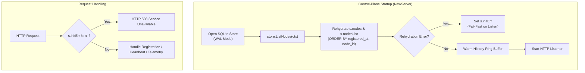

# Control-Plane Storage and Durable Node Registry Architecture

## 1. Overview

In AegisEdge Phase 6.28 Stage 5, the control-plane node registry is persisted durably in SQLite and rehydrated into in-memory structures upon startup. This guarantees that edge node registrations, heartbeats, and telemetry activity survive control-plane process restarts while preserving AegisEdge's core invariant:

$$\text{EDGE OPERATES OFFLINE} \longrightarrow \text{PERSISTS TO WAL} \longrightarrow \text{RECONNECTS} \longrightarrow \text{SYNCHRONIZES IDEMPOTENTLY}$$

---

## 2. Storage Schema (`cp_nodes`)

The node registry is stored in the `cp_nodes` table within the control-plane SQLite database alongside `cp_ingested_batches` and `cp_telemetry_payloads`.

```sql
CREATE TABLE IF NOT EXISTS cp_nodes (
    node_id           TEXT PRIMARY KEY NOT NULL,
    status            TEXT NOT NULL,
    last_seen         TEXT NOT NULL,
    registered_at     TEXT NOT NULL,
    agent_version     TEXT NOT NULL DEFAULT '',
    protocol_version  TEXT NOT NULL DEFAULT '',
    hostname          TEXT NOT NULL DEFAULT '',
    os                TEXT NOT NULL DEFAULT '',
    architecture      TEXT NOT NULL DEFAULT '',
    capabilities_json TEXT NOT NULL DEFAULT '[]',
    labels_json       TEXT NOT NULL DEFAULT '{}',
    sequence_number   INTEGER NOT NULL DEFAULT 0,
    created_at        TEXT NOT NULL DEFAULT CURRENT_TIMESTAMP,
    updated_at        TEXT NOT NULL DEFAULT CURRENT_TIMESTAMP
);

CREATE INDEX IF NOT EXISTS idx_cp_nodes_reg_order 
    ON cp_nodes(registered_at ASC, node_id ASC);

CREATE INDEX IF NOT EXISTS idx_cp_nodes_last_seen 
    ON cp_nodes(last_seen ASC);
```

### Key Design Properties
1. **Primary Key:** `node_id TEXT NOT NULL` guarantees device uniqueness.
2. **Timestamps:** Canonical `time.RFC3339Nano` UTC strings format timestamps across `registered_at`, `last_seen`, `created_at`, and `updated_at`.
3. **Structured Collections:** `capabilities_json` and `labels_json` serialize arrays and maps cleanly with safe default values (`'[]'`, `'{}'`).
4. **Deterministic Ordering Index:** The composite index `idx_cp_nodes_reg_order ON cp_nodes(registered_at ASC, node_id ASC)` guarantees a deterministic, tie-broken query ordering across database restarts without relying on SQLite internal rowids.

---

## 3. Storage Contracts and Semantics

The storage interface `IdempotencyStore` (`services/control-plane/storage/store.go`) defines the node persistence contract:

### 3.1 Node Registration (`RegisterNode`)
- **Initial Registration:** Inserts a new record into `cp_nodes`. Returns `(isNew = true, nil)`.
- **Duplicate Registration:**
  - `registered_at` is **immutable** and preserved from initial enrollment.
  - `status` is **preserved** (never resets a node that might be `DEGRADED` or `OFFLINE` back to default).
  - `sequence_number` is **monotonic** (never regresses; `MAX(existing, requested)`).
  - `last_seen` is updated to the current registration timestamp.
  - Optional metadata (`hostname`, `agent_version`, `protocol_version`, `os`, `architecture`, `capabilities`, `labels`) updates **only if non-empty / non-zero**, preventing accidental erasure of existing metadata.
  - Returns `(isNew = false, nil)`.

### 3.2 Heartbeat Updates (`UpdateNodeHeartbeat`)
- Verifies node existence via `SELECT 1 FROM cp_nodes WHERE node_id = ?`. If missing, returns `ErrNodeNotFound` (HTTP 404). This prevents SQLite's `RowsAffected() == 0` quirk from falsely reporting missing nodes when heartbeat fields remain identical.
- Monotonically advances `sequence_number` (`CASE WHEN ? > sequence_number THEN ? ELSE sequence_number END`).
- Updates `last_seen` to the control-plane ingestion timestamp.

### 3.3 Atomic Telemetry Ingestion (`RecordBatch`)
- Insertion of idempotency metadata (`cp_ingested_batches`), complete payload (`cp_telemetry_payloads`), and registered-node activity update (`cp_nodes`) execute in a **single SQLite transaction**.
- **Single Disk Fsync:** In SQLite WAL mode with `PRAGMA synchronous=FULL;`, all three operations commit in one disk fsync before HTTP `201 Created` or NATS `msg.Ack()`.
- **Duplicate Batches:** Duplicate batches roll back at step 1; duplicate telemetry **never mutates node activity**.
- **Unknown Nodes:** If telemetry arrives from an unknown/unregistered node, the `UPDATE cp_nodes` query matches 0 rows and returns `nil` error; the batch and payload are accepted idempotently without synthesizing a phantom registered node.
- **Rollback Safety:** Any failure during the transaction rolls back batch, payload, and node updates together.

---

## 4. Server Lifecycle and Concurrency Strategy



### 4.1 Safe Lock Ordering and Reconciliation
- **Disk I/O Precedes Lock Acquisition:** Storage persistence is executed outside `s.mu` (the global server mutex). SQLite connection serialization handles database concurrency via `busy_timeout=5000`.
- **Memory Mutated Only After Durable Storage:** In-memory maps (`s.nodes`, `s.nodesList`) are only updated after the database transaction successfully commits. If SQLite returns an error, the HTTP handler returns 500 without modifying in-memory state.
- **Monotonic Memory Reconciliation:** Under `s.mu.Lock()`, sequence numbers and `last_seen` timestamps only advance forward, ensuring concurrent out-of-order goroutines cannot overwrite newer state with stale values.

### 4.2 Fail-Fast Rehydration
If storage access fails during startup rehydration:
- `NewServer` records `s.initErr`.
- In `main.go`, `srvInstance.InitError()` logs a fatal error and terminates with exit code 1.
- In HTTP handlers, `s.initErr` immediately triggers `503 Service Unavailable` (`service_uninitialized`), preventing the server from silently serving an empty or incomplete registry.
